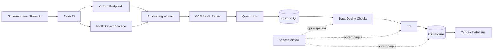

# Платформа обработки и аналитики судебных документов

End-to-end Data Engineering платформа для автоматической обработки, проверки качества и аналитики судебных и исполнительных документов.

Проект начинался как OCR/LLM-ассистент для обработки судебных документов, а затем был расширен до полноценного Data Engineering пайплайна с событийной архитектурой, объектным хранилищем, аналитическими витринами, Data Quality проверками, оркестрацией и BI-дашбордом.

## О проекте

Система принимает PDF и XML документы, распознаёт и извлекает из них структурированные данные, сохраняет историю обработки и формирует аналитические витрины для мониторинга качества и статусов обработки.

Основной поток данных:

```text
Загрузка документа
        ↓
     FastAPI
        ↓
      MinIO
        ↓
Kafka / Redpanda
        ↓
Processing Worker
        ↓
 OCR / XML / LLM
        ↓
   PostgreSQL
        ↓
 Data Quality
        ↓
       dbt
        ↓
   ClickHouse
        ↓
Yandex DataLens
```

Apache Airflow оркестрирует аналитическую часть пайплайна:

```text
Data Quality → dbt Build → ClickHouse Sync
```

## Архитектура



## Технологический стек

### Data Engineering

- **PostgreSQL** — операционное и staging-хранилище
- **Apache Kafka / Redpanda** — событийная обработка документов
- **MinIO** — S3-совместимое объектное хранилище
- **dbt** — трансформация данных и построение витрин
- **ClickHouse** — аналитическое OLAP-хранилище
- **Apache Airflow** — оркестрация пайплайнов
- **Yandex DataLens** — BI и визуализация данных
- **Docker / Docker Compose** — локальная инфраструктура

### Backend и обработка документов

- **Python**
- **FastAPI**
- **SQLAlchemy**
- **PyMuPDF**
- **Tesseract OCR**
- **OpenCV**
- **lxml**
- **Ollama**
- **Qwen**

### Frontend

- **React**
- **TypeScript**
- **Ant Design**

## Как работает пайплайн

### 1. Ingestion

Пользователь загружает PDF или XML документ через веб-интерфейс.

FastAPI:

- создаёт метаданные документа;
- сохраняет исходный файл в MinIO;
- публикует событие `document_uploaded` в Kafka.

### 2. Асинхронная обработка

Processing Worker читает сообщения из Redpanda/Kafka.

Для каждого документа он:

1. скачивает исходный файл из MinIO;
2. извлекает текст из PDF или XML;
3. запускает OCR для сканированных документов;
4. извлекает структурированные поля с помощью локальной LLM;
5. валидирует результат;
6. сохраняет данные в PostgreSQL.

Для ошибочных сообщений реализованы retry и Dead Letter Queue.

Kafka topics:

```text
document.processing
document.processing.dlq
```

## Staging-слой

Каждая попытка обработки сохраняется отдельно в PostgreSQL.

Это позволяет хранить историю обработки и анализировать результаты повторных запусков.

Основные поля:

- тип документа;
- номер дела;
- дата дела;
- данные должника;
- период задолженности;
- основной долг;
- пени;
- госпошлина;
- статус обработки;
- отсутствующие поля;
- предупреждения;
- информация о модели;
- время обработки.

## Data Quality

Перед построением аналитических витрин выполняются автоматические проверки качества данных.

Реализовано 13 Data Quality проверок:

- дубликаты исходных файлов;
- некорректные статусы документов;
- обработанные документы без типа;
- отрицательные денежные значения;
- некорректные processing statuses;
- дубли processing attempts;
- отрицательная длительность обработки;
- ошибки обработки без error message;
- некорректный ИНН;
- некорректный СНИЛС;
- некорректный формат дат;
- неправильный период задолженности;
- отсутствие номера дела у успешно обработанного документа.

Если критическая проверка не проходит, дальнейшая аналитическая обработка останавливается.

Пример успешного запуска:

```text
Checks total: 13
Checks failed: 0
DATA QUALITY PASSED
```

## dbt слой

dbt используется для преобразования операционных данных PostgreSQL в аналитические модели.

### Staging models

```text
stg_documents
stg_document_extractions
stg_processing_events
```

### Intermediate layer

```text
int_documents_enriched
```

### Data marts

```text
mart_document_processing_daily
mart_document_quality
mart_document_types
mart_legal_actions
```

Витрины используются для анализа:

- количества поступающих документов;
- успешности обработки;
- качества извлечения;
- типов документов;
- количества ошибок;
- документов на ручной проверке;
- документов, требующих работы юриста;
- сумм задолженности.

## ClickHouse

После выполнения dbt аналитические витрины синхронизируются в ClickHouse.

ClickHouse используется как отдельный аналитический слой для быстрых OLAP-запросов и BI.

Примеры метрик:

- количество поступивших документов;
- количество успешно обработанных документов;
- количество ошибок;
- количество документов на проверке;
- success rate;
- quality rate;
- среднее время обработки;
- распределение по типам документов;
- сумма задолженности;
- документы, требующие работы юриста.

## Apache Airflow

Airflow управляет аналитической частью пайплайна.

DAG:

```text
document_analytics_pipeline
```

Последовательность задач:

```text
run_python_dq
      ↓
dbt_build
      ↓
sync_clickhouse
```

Таким образом, dbt и ClickHouse запускаются только после успешного прохождения Data Quality проверок.


## Event Streaming

Redpanda используется как Kafka-compatible брокер сообщений.

Он позволяет отделить загрузку документа от тяжёлой OCR/LLM обработки и выполнять её асинхронно.


## BI-дашборд

Для аналитики используется Yandex DataLens.

Дашборд содержит:

- успешность обработки документов;
- качество извлечения;
- количество документов на проверке;
- динамику поступления документов;
- распределение по типам;
- проблемы качества данных;
- долю документов на проверке;
- документы, требующие работы юриста.


## Веб-интерфейс

React-интерфейс позволяет:

- загружать документы;
- отслеживать статус обработки;
- просматривать список документов;
- открывать карточку документа;
- видеть извлечённые данные;
- работать с документами, требующими ручной проверки.


## Надёжность пайплайна

В проекте реализованы:

- асинхронная обработка документов;
- Kafka consumer;
- ручной commit offset;
- retry mechanism;
- Dead Letter Queue;
- история попыток обработки;
- Data Quality gates;
- dbt tests;
- контроль статусов документов;
- хранение оригинальных файлов в MinIO;
- разделение OLTP и OLAP слоёв.

## Структура репозитория

```text
.
├── airflow/
│   └── dags/
│       └── document_analytics_pipeline.py
│
├── backend/
│   ├── app/
│   │   ├── api/
│   │   ├── dq/
│   │   ├── models/
│   │   ├── services/
│   │   └── workers/
│   └── run_dq_checks.py
│
├── clickhouse/
│   ├── docker-compose.yml
│   ├── init.sql
│   └── sync_marts.py
│
├── dbt/
│   └── court_documents_analytics/
│
├── document_processing/
│
├── frontend/
│
├── minio/
│
├── redpanda/
│   └── docker-compose.yml
│
└── docs/
    └── images/
```

## Локальные сервисы

| Сервис | Порт |
|---|---:|
| React frontend | 5173 |
| FastAPI | 8000 |
| PostgreSQL | 55432 |
| MinIO API | 9000 |
| MinIO Console | 9001 |
| Redpanda Kafka | 9092 |
| Redpanda Console | 8083 |
| Airflow | 8081 |
| ClickHouse HTTP | 8123 |
| ClickHouse Native | 9002 |

## Пример полного Data Flow

```text
ocr_014.pdf
    ↓
FastAPI
    ↓
MinIO
    ↓
Kafka event
    ↓
Processing Worker
    ↓
OCR + Qwen
    ↓
PostgreSQL
    ↓
Data Quality
    ↓
dbt
    ↓
ClickHouse
    ↓
DataLens
```

## Поддерживаемые документы

Система работает с:

- PDF со сканами;
- PDF с текстовым слоем;
- XML документами ФССП.

Поддерживаемые типы документов:

- судебный приказ;
- исполнительный лист;
- постановление ФССП.

Система также определяет, может ли документ быть обработан автоматически или требует ручной проверки.

## История проекта

Первая версия проекта была разработана в рамках хакатона **«ИИ-ассистенты для энергетики» от Интер РАО** в треке по автоматической обработке судебных документов.

Изначально MVP решал задачи:

- OCR;
- классификации документов;
- извлечения структурированных данных;
- определения документов, требующих работы юриста.

После хакатона проект был расширен до полноценной Data Engineering платформы.

Были добавлены:

- Kafka / Redpanda;
- MinIO;
- PostgreSQL staging layer;
- Data Quality проверки;
- dbt;
- ClickHouse;
- Airflow;
- DataLens.

## Что демонстрирует проект

Проект показывает практическую работу с:

- ETL / ELT пайплайнами;
- event-driven архитектурой;
- брокерами сообщений;
- объектными хранилищами;
- OLTP и OLAP базами данных;
- staging и analytical layers;
- Data Quality;
- workflow orchestration;
- retry / DLQ pattern;
- dbt transformations;
- BI-аналитикой;
- Docker-инфраструктурой.

## Статус проекта

End-to-end пайплайн работает локально:

```text
Upload
→ MinIO
→ Kafka
→ Worker
→ OCR / LLM
→ PostgreSQL
→ Data Quality
→ dbt
→ ClickHouse
→ DataLens
```

Проект используется как Data Engineering pet-project и продолжает развиваться.