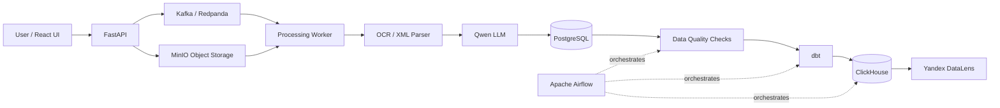
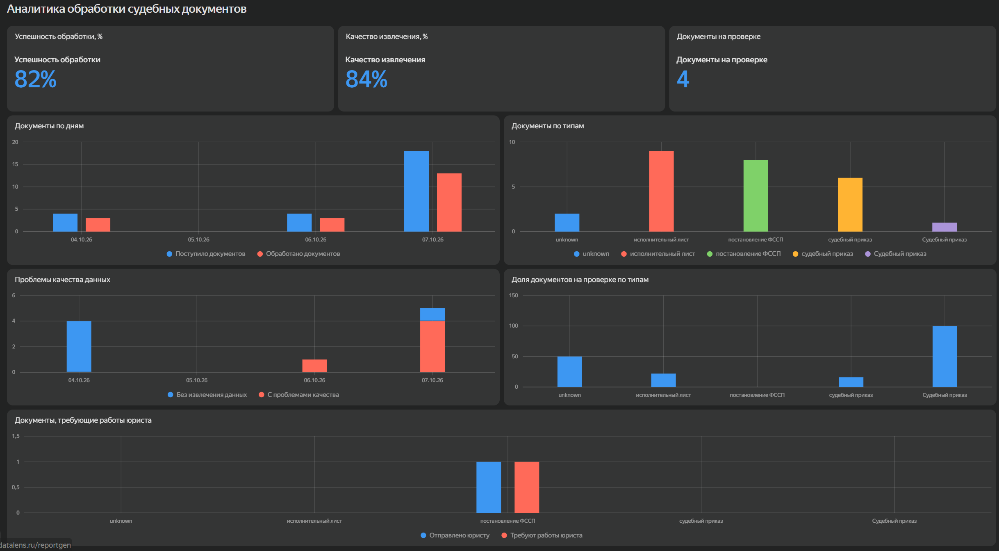
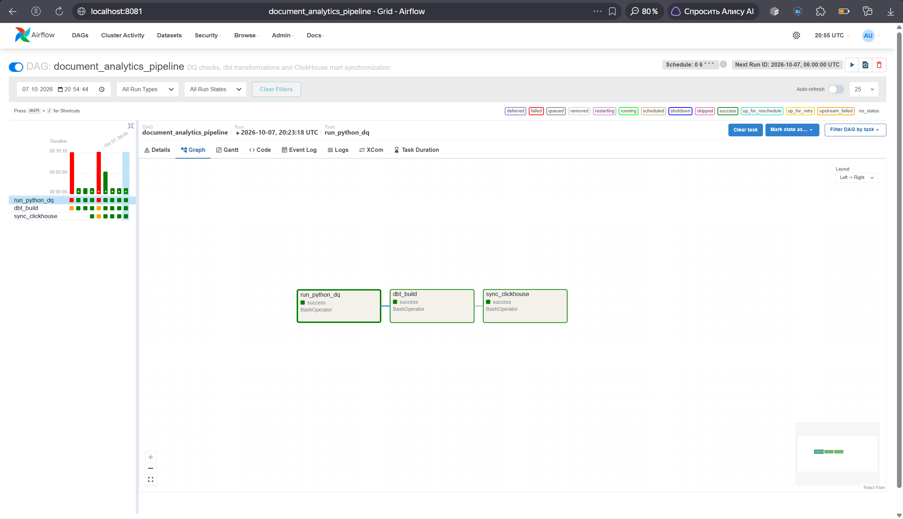
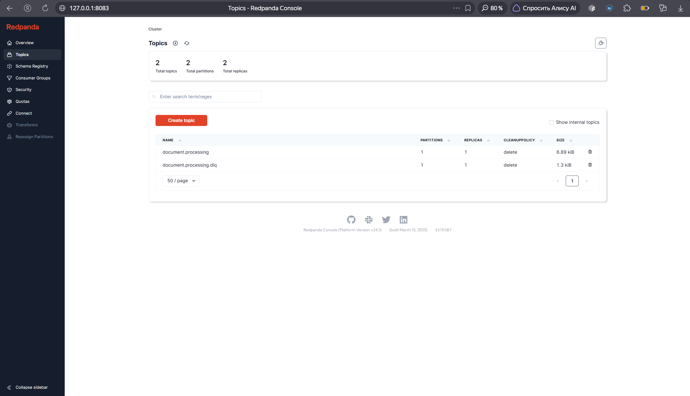
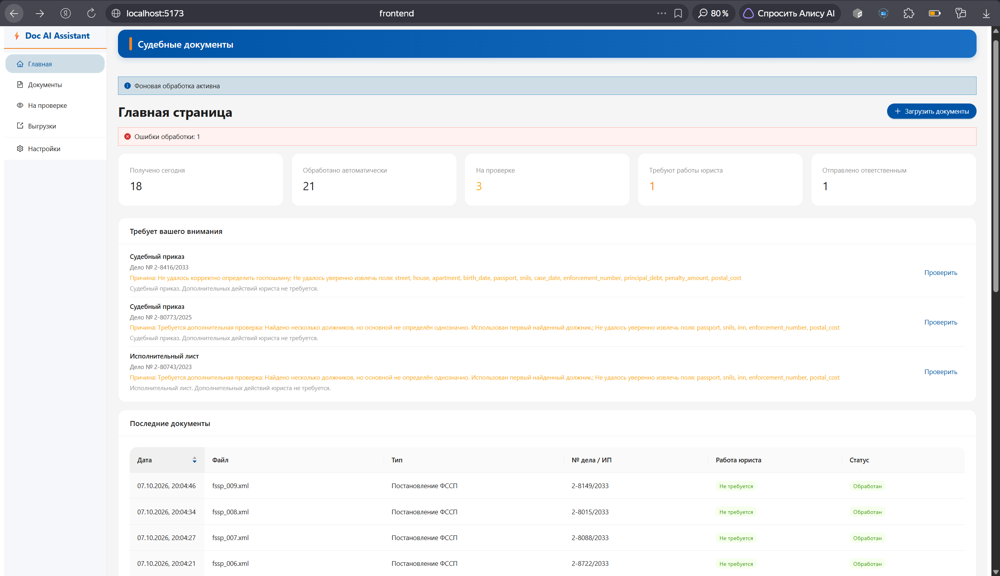

# Court Documents AI & Data Engineering Platform

End-to-end data platform for automated processing, validation and analytics of court and enforcement documents.

The project started as an OCR/LLM assistant for processing judicial documents and was later extended into a full Data Engineering pipeline with event-driven ingestion, object storage, analytical transformations, data quality checks, orchestration and BI reporting.

## Overview

The system processes PDF scans, text-based PDFs and XML documents, extracts structured information and builds analytical data marts for monitoring document processing quality and operational metrics.

Core workflow:

```text
Document Upload
      ↓
   FastAPI
      ↓
    MinIO
      ↓
Kafka / Redpanda
      ↓
Processing Worker
      ↓
 OCR / XML / LLM
      ↓
 PostgreSQL
      ↓
Data Quality Checks
      ↓
     dbt
      ↓
 ClickHouse
      ↓
  Yandex DataLens
```

Apache Airflow orchestrates the analytical part of the pipeline:

```text
Data Quality → dbt Build → ClickHouse Sync
```

## Architecture



## Tech Stack

### Data Engineering

- **PostgreSQL** — operational and staging storage
- **Apache Kafka / Redpanda** — event-driven document processing
- **MinIO** — S3-compatible object storage for source documents
- **dbt** — transformation and analytical data marts
- **ClickHouse** — analytical OLAP storage
- **Apache Airflow** — pipeline orchestration
- **Yandex DataLens** — BI dashboards and visualization
- **Docker / Docker Compose** — local infrastructure

### Backend and Processing

- **Python**
- **FastAPI**
- **SQLAlchemy**
- **PyMuPDF**
- **Tesseract OCR**
- **OpenCV**
- **lxml**
- **Ollama**
- **Qwen**

### Frontend

- **React**
- **TypeScript**
- **Ant Design**

## Data Pipeline

### 1. Ingestion

A user uploads a PDF or XML document through the web interface.

FastAPI:

- creates document metadata;
- stores the original file in MinIO;
- publishes a `document_uploaded` event to Kafka.

### 2. Event-driven processing

The processing worker consumes messages from Redpanda/Kafka.

For every document it:

1. downloads the source file from MinIO;
2. extracts text from PDF or XML;
3. runs OCR for scanned documents;
4. extracts structured fields using a local LLM;
5. validates processing results;
6. stores the result in PostgreSQL.

The worker implements retries and Dead Letter Queue processing for failed messages.

Kafka topics:

```text
document.processing
document.processing.dlq
```

### 3. Staging layer

Each processing attempt is stored independently in PostgreSQL.

Example fields:

- document type;
- court case number;
- case date;
- debtor information;
- debt period;
- principal debt;
- penalty amount;
- state duty;
- processing status;
- missing fields;
- validation warnings;
- model and processing metadata.

This preserves processing history and makes pipeline behavior auditable.

## Data Quality

Before analytical transformations are executed, the pipeline runs automated Data Quality checks.

Currently implemented checks include:

- duplicate source files;
- invalid document statuses;
- processed documents without document type;
- negative monetary values;
- invalid processing statuses;
- duplicate processing attempts;
- negative event duration;
- processing errors without an error message;
- invalid INN;
- invalid SNILS;
- invalid date formats;
- invalid debt periods;
- missing case numbers.

Current pipeline:

```text
13 Data Quality checks
```

A failed critical check stops downstream analytical processing.

## dbt Transformation Layer

dbt transforms operational PostgreSQL data into analytical models.

### Staging models

```text
stg_documents
stg_document_extractions
stg_processing_events
```

### Intermediate layer

```text
int_documents_enriched
```

### Data marts

```text
mart_document_processing_daily
mart_document_quality
mart_document_types
mart_legal_actions
```

The marts provide metrics for document throughput, processing quality, document types and legal-action routing.

## ClickHouse Analytics Layer

The resulting marts are synchronized into ClickHouse for analytical workloads.

Examples of available metrics:

- number of received documents;
- successfully processed documents;
- failed documents;
- documents requiring manual review;
- processing success rate;
- extraction quality rate;
- processing time;
- distribution by document type;
- debt amounts;
- documents requiring legal action.

## Airflow Orchestration

Apache Airflow controls the analytical pipeline.

DAG:

```text
document_analytics_pipeline
```

Execution flow:

```text
run_python_dq
      ↓
dbt_build
      ↓
sync_clickhouse
```

A dbt build or ClickHouse synchronization is executed only after Data Quality validation succeeds.

## BI Dashboard

Yandex DataLens is used to visualize analytical marts.

The dashboard contains:

- processing success rate;
- extraction quality rate;
- documents requiring manual review;
- document volume over time;
- distribution by document type;
- data quality issues;
- review rate by document type;
- documents requiring legal work.



## Airflow DAG

The analytical workflow is orchestrated through Apache Airflow.



## Event Streaming

Redpanda provides Kafka-compatible event streaming for asynchronous document processing.



## Web Interface

The React interface allows users to upload documents, monitor processing status and inspect extracted information.



## Reliability Features

The pipeline includes:

- asynchronous event-driven processing;
- manual Kafka offset commits;
- retry handling;
- Dead Letter Queue;
- immutable processing attempts;
- Data Quality gates;
- dbt tests;
- document status tracking;
- object storage for original files;
- analytical separation between PostgreSQL and ClickHouse.

## Repository Structure

```text
.
├── airflow/
│   └── dags/
│       └── document_analytics_pipeline.py
│
├── backend/
│   ├── app/
│   │   ├── api/
│   │   ├── models/
│   │   ├── services/
│   │   └── workers/
│   └── run_dq_checks.py
│
├── clickhouse/
│   ├── docker-compose.yml
│   ├── init.sql
│   └── sync_marts.py
│
├── dbt/
│   └── court_documents_analytics/
│
├── document_processing/
│
├── frontend/
│
├── minio/
│
├── redpanda/
│   └── docker-compose.yml
│
└── docs/
    └── images/
```

## Local Services

The platform runs locally using Docker and development services.

| Service | Port |
|---|---:|
| React frontend | 5173 |
| FastAPI | 8000 |
| PostgreSQL | 55432 |
| MinIO API | 9000 |
| MinIO Console | 9001 |
| Redpanda Kafka | 9092 |
| Redpanda Console | 8083 |
| Airflow | 8081 |
| ClickHouse HTTP | 8123 |
| ClickHouse Native | 9002 |

## Example Data Flow

```text
ocr_014.pdf
    ↓
FastAPI upload
    ↓
MinIO object
    ↓
document_uploaded Kafka event
    ↓
Processing Worker
    ↓
OCR + Qwen extraction
    ↓
PostgreSQL staging
    ↓
Data Quality
    ↓
dbt marts
    ↓
ClickHouse
    ↓
DataLens
```

## Document Processing

Supported document sources include:

- scanned PDF documents;
- PDFs with text layer;
- XML enforcement documents.

Supported document categories include:

- court orders;
- writs of execution;
- enforcement service decisions.

The processing layer extracts structured fields and determines whether a document can be processed automatically or requires manual review.

## Project Background

The original MVP was developed for the **Inter RAO AI Assistants for Energy Hackathon** in the court-document processing track.

The initial solution focused on OCR, document classification and structured field extraction.

The project was subsequently expanded as a Data Engineering portfolio project with:

- Kafka-based event streaming;
- MinIO object storage;
- PostgreSQL staging and processing history;
- automated Data Quality checks;
- dbt transformations;
- ClickHouse analytical storage;
- Airflow orchestration;
- DataLens dashboards.

## Key Engineering Concepts Demonstrated

This project demonstrates practical experience with:

- ETL / ELT pipelines;
- event-driven architecture;
- message queues;
- object storage;
- OLTP and OLAP databases;
- dimensional analytical layers;
- data quality validation;
- workflow orchestration;
- retry and DLQ patterns;
- dbt transformations and testing;
- BI analytics;
- containerized infrastructure.

## Status

The end-to-end local pipeline is operational:

```text
Upload
→ Object Storage
→ Kafka
→ Worker
→ OCR / LLM
→ PostgreSQL
→ Data Quality
→ dbt
→ ClickHouse
→ DataLens
```

The project is being developed further as a Data Engineering portfolio project.