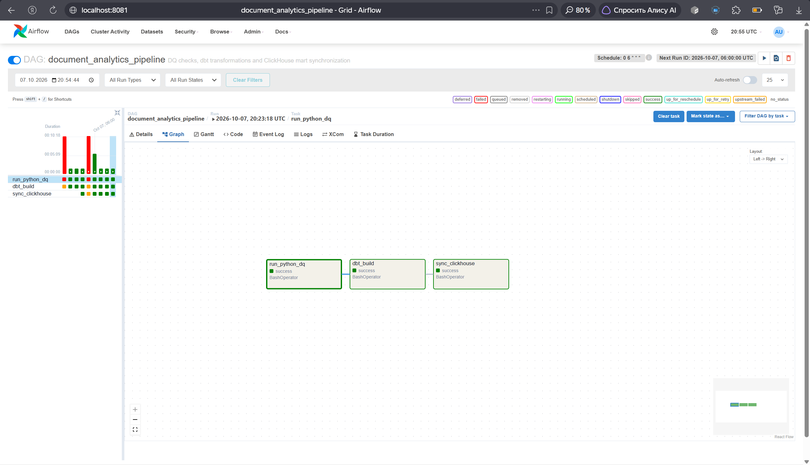
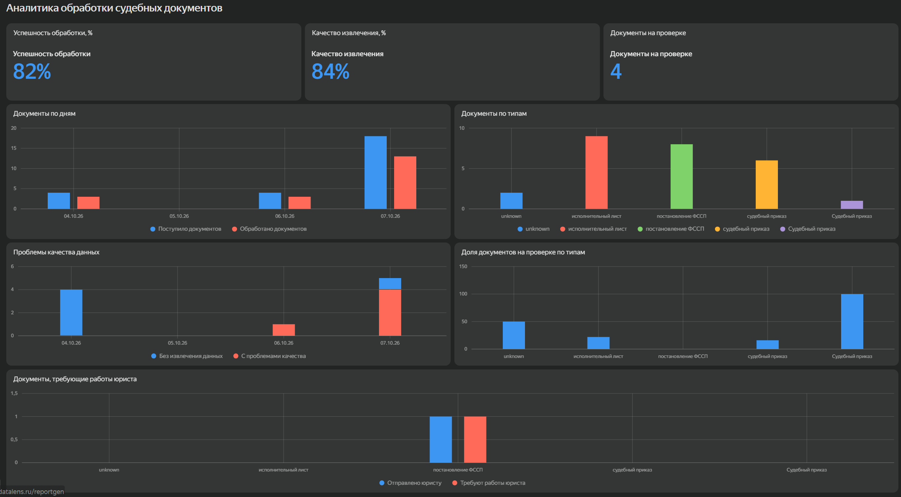
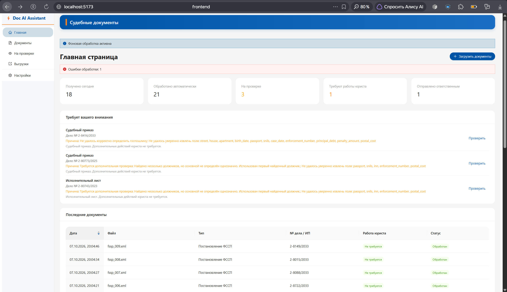

# Платформа обработки и аналитики судебных документов

Система автоматизированной обработки судебных и исполнительных документов с использованием OCR, локальной LLM и инструментов Data Engineering.

Проект разработан в рамках хакатона «ИИ-ассистенты для энергетики», трек «Помощник для анализа документов из судов (OCR и извлечение данных)».

## О проекте

Система принимает судебные документы в форматах PDF и XML, извлекает структурированные данные, определяет необходимость ручной проверки и дальнейших юридических действий.

Дополнительно реализован аналитический пайплайн для мониторинга качества извлечения, ошибок и статусов обработки.

Основные возможности:

- Загрузка и хранение исходных PDF/XML.
- Распознавание сканированных документов.
- Извлечение реквизитов с помощью локальной LLM.
- Классификация документов.
- Автоматические проверки качества данных.
- История обработки и повторные попытки.
- Формирование аналитических витрин.
- Экспорт результатов в XLSX/CSV.
- Веб-интерфейс для проверки документов.

## Архитектура

```text
                  PDF / XML
                     |
                     v
                   FastAPI
                     |
              +------+------+
              |             |
              v             v
            MinIO       PostgreSQL
         Исходные файлы processing_jobs
                            |
                            v
                     Processing Worker
                            |
                            v
                      OCR / XML / LLM
                            |
                            v
                       PostgreSQL
                    Результаты обработки
                            |
                            v
                       Data Quality
                            |
                            v
                           dbt
                            |
                            v
                       PostgreSQL
                     analytics schema
                            |
                            v
                      BI / DataLens
```

Apache Airflow управляет аналитическим пайплайном:

```text
run_python_dq
      |
      v
   dbt_build
```

Обработка документов выполняется отдельным worker, который получает задания из PostgreSQL.

## Технологический стек

### Data Engineering

- Python — обработка и загрузка данных.
- PostgreSQL — операционное хранилище, очередь заданий и аналитические витрины.
- SQLAlchemy — работа с базой данных.
- Alembic — миграции схемы БД.
- MinIO — S3-совместимое хранение исходных документов.
- Apache Airflow — оркестрация аналитического пайплайна.
- dbt — SQL-трансформации и аналитические модели.
- Data Quality — автоматические проверки корректности данных.
- Docker / Docker Compose — контейнеризация инфраструктуры.

### Backend и обработка документов

- FastAPI
- PyMuPDF
- Tesseract OCR
- OpenCV
- lxml
- Ollama
- Qwen

### Frontend

- React
- TypeScript
- Ant Design

## Обработка документов

### 1. Загрузка данных

Пользователь загружает PDF или XML через веб-интерфейс.

FastAPI:

1. Проверяет формат файла.
2. Рассчитывает SHA-256 и проверяет дубликаты.
3. Сохраняет оригинал в MinIO.
4. Создаёт документ в PostgreSQL.
5. Добавляет задание в таблицу `processing_jobs`.

Документ и задание сохраняются одной транзакцией БД.

### 2. Асинхронная обработка

Processing Worker периодически проверяет PostgreSQL на наличие новых заданий.

Для конкурентного получения заданий используется `SELECT ... FOR UPDATE SKIP LOCKED`.

Worker:

1. Получает задание из очереди.
2. Загружает документ из MinIO.
3. Извлекает текст из PDF или XML.
4. Выполняет OCR для сканированных документов.
5. Использует локальную LLM для извлечения реквизитов.
6. Валидирует результат.
7. Сохраняет данные в PostgreSQL.
8. Обновляет статус задания.

### 3. Повторные попытки

Для обработки ошибок реализованы:

- До трёх попыток выполнения задания.
- Задержка перед повторной обработкой.
- Сохранение последней ошибки.
- Heartbeat во время длительной обработки.
- Повторное получение зависших заданий после истечения времени блокировки.
- Перевод задания в `failed` после исчерпания попыток.

Статусы очереди:

- `pending` — ожидает обработки.
- `processing` — выполняется.
- `completed` — успешно завершено.
- `failed` — обработка завершилась ошибкой.

История ошибок и повторных попыток сохраняется в PostgreSQL.

## Staging-слой

В PostgreSQL сохраняются извлечённые данные и события обработки.

Для аналитики используются сведения о:

- Типе документа.
- Номере судебного дела.
- Должниках.
- Суммах задолженности.
- Периодах задолженности.
- Статусах обработки.
- Недостающих полях.
- Предупреждениях.
- Длительности обработки.
- Ошибках и повторных попытках.

Staging-слой позволяет отделить исходные результаты извлечения от аналитических представлений.

## Data Quality

В проекте реализовано 13 автоматических проверок качества данных:

1. Дубликаты исходных файлов.
2. Некорректные статусы документов.
3. Обработанные документы без типа.
4. Отрицательные денежные значения.
5. Некорректные статусы обработки.
6. Дубли попыток обработки.
7. Отрицательная длительность обработки.
8. Ошибки без сообщения об ошибке.
9. Некорректный ИНН.
10. Некорректный СНИЛС.
11. Некорректный формат дат.
12. Неправильный период задолженности.
13. Отсутствие номера дела у успешно обработанного документа.

Проверки выполняются перед построением аналитических витрин.

При обнаружении критических ошибок дальнейшая аналитическая обработка останавливается.

## dbt: трансформации и аналитические витрины

dbt используется для преобразования данных PostgreSQL в аналитические модели.

### Staging

- `stg_documents`
- `stg_document_extractions`
- `stg_processing_events`

### Intermediate

- `int_documents_enriched`

### Data Marts

- `mart_document_processing_daily`
- `mart_document_quality`
- `mart_document_types`
- `mart_legal_actions`

Модели staging и intermediate материализуются как SQL views.

Аналитические витрины материализуются как таблицы PostgreSQL в схеме `analytics`.

### Аналитические показатели

Витрины позволяют анализировать:

- Количество поступивших документов.
- Долю успешно обработанных документов.
- Количество ошибок.
- Среднее время обработки.
- Качество извлечения данных.
- Распределение документов по типам.
- Документы на ручной проверке.
- Документы, требующие действий юриста.
- Суммы задолженности.
- Динамику обработки документов.

## Apache Airflow

Airflow управляет последовательностью выполнения аналитических задач.

DAG: `document_analytics_pipeline`

```text
run_python_dq
      |
      v
   dbt_build
```

Пайплайн настроен на ежедневный запуск в 06:00.

Перед выполнением dbt запускаются проверки Data Quality.

Для задач настроены повторные попытки и ограничение количества одновременных запусков DAG.



## BI-аналитика

Для визуализации аналитических показателей в проекте использовался Yandex DataLens.

Дашборд содержит показатели качества извлечения, статусов обработки, ошибок и документов, требующих внимания юриста.

После упрощения архитектуры аналитические витрины формируются непосредственно в PostgreSQL.

Подключение ранее созданного DataLens-дашборда к обновлённому источнику PostgreSQL требует отдельной проверки.



## Веб-интерфейс

React-приложение позволяет:

- Загружать документы.
- Просматривать журнал документов.
- Отслеживать статусы обработки.
- Открывать карточки документов.
- Просматривать извлечённые реквизиты.
- Исправлять и подтверждать данные.
- Работать с документами на ручной проверке.
- Экспортировать результаты в XLSX/CSV.
- Отправлять документы ответственному сотруднику по электронной почте.



## Поддерживаемые документы

Форматы:

- PDF с текстовым слоем.
- Сканированные PDF.
- XML-документы ФССП.

Типы документов:

- Судебный приказ.
- Исполнительный лист.
- Постановление ФССП.

Система различает техническую необходимость проверки извлечённых данных и необходимость юридических действий.

## Структура проекта

```text
court-documents-ai-assistant/
|
|-- airflow/
|   |-- dags/
|   |   `-- document_analytics_pipeline.py
|   |-- config/
|   `-- docker-compose.yml
|
|-- backend/
|   |-- alembic/
|   |-- app/
|   |   |-- api/
|   |   |-- models/
|   |   |   `-- processing_job.py
|   |   |-- services/
|   |   |-- workers/
|   |   |   `-- document_worker.py
|   |   `-- dq/
|   |-- run_dq_checks.py
|   `-- docker-compose.yml
|
|-- dbt/
|   `-- court_documents_analytics/
|
|-- document_processing/
|
|-- frontend/
|
|-- minio/
|   `-- docker-compose.yml
|
|-- docs/
|
`-- README.md
```

## Локальная инфраструктура

| Сервис | Порт |
|---|---|
| React frontend | 5173 |
| FastAPI | 8000 |
| PostgreSQL | 55432 |
| MinIO API | 9000 |
| MinIO Console | 9001 |
| Airflow Webserver | 8081 |

PostgreSQL используется для операционных данных и аналитических витрин.

У Airflow отдельная служебная база данных для хранения состояния оркестратора.

## Надёжность обработки

В архитектуре предусмотрены:

- Транзакционное создание документов и заданий.
- Очередь обработки на PostgreSQL.
- Конкурентное получение заданий с блокировкой строк.
- Повторные попытки.
- Heartbeat для длительных задач.
- Учёт зависших заданий.
- История обработки и ошибок.
- Data Quality gates.
- dbt tests.
- Контроль статусов документов.
- Хранение исходных файлов отдельно от структурированных данных.

При аварийных сбоях возможна повторная обработка задания. Для строгой гарантии однократной записи результатов необходима дополнительная проверка идемпотентности.

## Что демонстрирует проект

Проект показывает практическую работу с:

- ETL/ELT-пайплайнами.
- PostgreSQL и SQLAlchemy.
- SQL-моделированием данных.
- Очередями заданий на базе PostgreSQL.
- Транзакциями и конкурентной обработкой.
- S3-совместимым объектным хранилищем.
- Staging и Data Marts.
- Data Quality.
- Apache Airflow.
- dbt и SQL-трансформациями.
- Docker-инфраструктурой.
- Интеграцией OCR и локальных LLM.

## Статус проекта

В рамках хакатона была реализована система обработки судебных документов и аналитический Data Engineering pipeline.

В рамках последующего рефакторинга архитектура была упрощена:

- Удалён отдельный брокер сообщений.
- Очередь заданий перенесена в PostgreSQL.
- Удалено отдельное аналитическое хранилище.
- Аналитические витрины оставлены в PostgreSQL.
- Сохранены Airflow, dbt, Data Quality и MinIO.

Проведены проверки синтаксиса Python, импортов модулей, структуры миграций Alembic и конфигурации dbt.

Сквозное тестирование обновлённой очереди после рефакторинга не проводилось.
